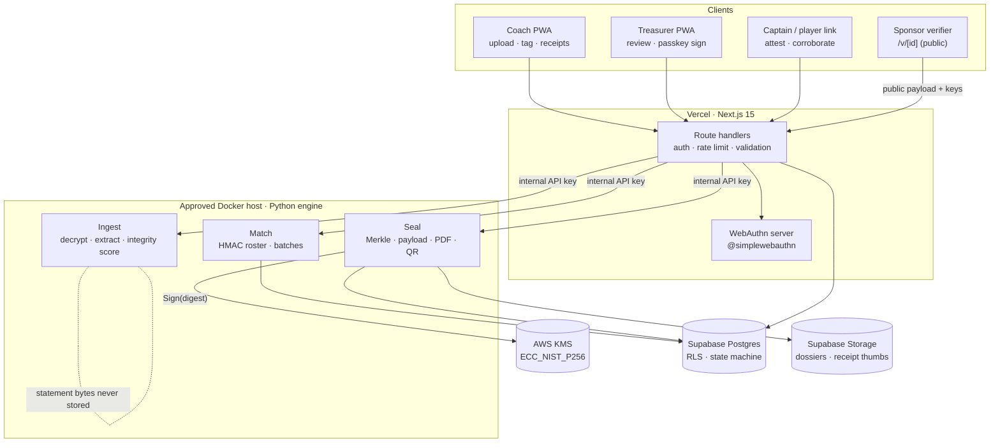
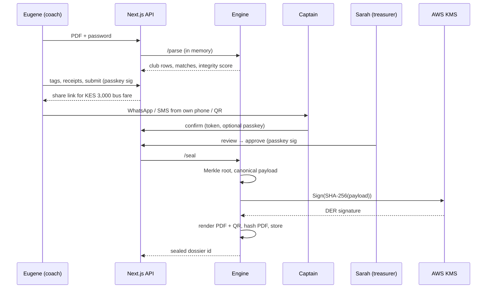

Coffee Powered Innovators · KamiLimu Cybersecurity Track

# SecurePitch Build Plan

A review of the SecurePitch design against the problem it sets out to solve, the scope changes that make it defensible, and an 11-day plan that splits the build between Chris, Catherine and Joy down to the file.

**Sprint:** Day 1 Thu 29 Oct → Day 11 Sun 8 Nov 2026 **Repo:** github.com/Mbjwanja1/SecurePitch **Feature freeze:** Day 8, 18:00 **Field test:** Day 9 with Lionesses

## 1. Does it solve the problem?

**Short answer**

It solves most of your *specific* problem (sponsors can't trust informal M-Pesa records) once three gaps are fixed. It does not, by itself, solve the *general* problem (getting the money), because your own field research says sponsors still can't pay a personal M-Pesa line. The pitch needs to say plainly what a sealed dossier unlocks.

The strongest parts are the privacy story (process in memory, keep only club rows) and the roster-bound attribution idea, which is original and fits the "paperless matatu" reality. The weakest parts are proving the uploaded statement is genuine, proving nothing was left out, and the fact that the "2-of-2 multi-sig" is currently a database flag, not a signature.

### Scorecard against the problem dimensions

| Problem dimension (from your research)             | As designed       | With changes in this plan | What closes the gap                                                                                                                 |
|----------------------------------------------------|-------------------|---------------------------|-------------------------------------------------------------------------------------------------------------------------------------|
| Surveillance trap: coach must expose personal life | **Solved**        | **Solved**                | Reword the claims so they survive questioning (see R7)                                                                              |
| Dossier tampered after it is issued                | **Solved**        | **Solved**                | Bind the PDF to the signed payload; QR uses URL fragment                                                                            |
| "One-man show" governance defect                   | **Partial**       | **Solved**                | Approvers sign with passkeys; signatures are embedded and checkable                                                                 |
| Unreceipted spend (matatu, allowances)             | **Partial**       | **Mostly**                | Random player corroboration on top of captain attestation                                                                           |
| Statement authenticity (Canva / Acrobat edits)     | **Weak**          | **Partial**               | Integrity score from balance-chain and summary reconciliation; source fingerprint for audit escalation                              |
| Completeness (coach hides club income or rows)     | **Not addressed** | **Partial**               | Tag inflows too; payload carries rows-total vs rows-disclosed                                                                       |
| Sponsor can't disburse to personal M-Pesa          | **Not addressed** | **Reframed**              | Dossier page 1 lists planned merchant spends so sponsors can pay suppliers directly; position dossier as evidence for bank / Form A |
| Digital divide (feature-phone coaches)             | **Partial**       | **Partial**               | WhatsApp-shared attestation links now; USSD on the roadmap                                                                          |

## 2. Technical review

Ordered by severity. Each finding has a fix that fits inside the 11 days. Expect judges on a cybersecurity track to probe R1, R2, R3 and R7 directly.

**Critical**

#### R1 · The platform seal proves "SecurePitch processed this", not "these payments happened"

The KMS signature over the Merkle root proves the dossier hasn't changed since sealing. It says nothing about whether the statement Eugene uploaded was genuine. A coach who fabricates a whole statement in a PDF editor gets a perfectly signed dossier. The "XREF and font dictionary" check is a weak heuristic: anyone who rebuilds the PDF from scratch passes it, and you have no baseline yet for what a genuine Safaricom file looks like.

**Fix** · Replace the single forensic check with an *integrity score* made of independent signals: (1) running balance continuity, where every row's balance equals the previous balance plus or minus the amount; (2) reconciliation of computed totals against the statement's own summary table of totals by transaction type; (3) metadata baseline (Producer, CreationDate equal to ModDate, zero incremental updates via the trailer `/Prev` chain, no annotations or forms), learned from 3–5 real statements on Day 1; (4) *independent corroboration*: the system picks 3 random roster-matched players and sends each a link asking "Did you receive KES 250 on 17/10?". A fabricated statement then needs several players to lie too. Store the SHA-256 of the original file in the signed payload so that, if an auditor ever doubts the dossier, the coach can privately show the original statement and anyone can check it hashes to the sealed fingerprint.

**Critical**

#### R2 · The 2-of-2 "multi-signature" is a status flag, not a signature

In the current design Eugene and Sarah click buttons, and then the *platform* signs with KMS. A verifier only learns that SecurePitch says both approved. Anyone with database access could flip the flags. That is the exact "trust one party" problem sponsors are trying to escape.

**Fix** · Each approver signs with their own passkey. The WebAuthn challenge is the SHA-256 of the canonical dossier payload. Store the assertion (`authenticatorData`, `clientDataJSON`, `signature`) and the credential public key, embed them in the sealed payload, and have the verifier check both assertions in the browser before checking the platform seal. This is the most valuable crypto feature you can add, and it reuses the WebAuthn work Catherine is already doing. Note that Eugene both prepares and approves, so Sarah is the only independent check; offer an optional third approver (club chair) as 2-of-3 on the roadmap.

**Critical**

#### R3 · Roster hashing is reversible and may not match real statements

Three problems. First, Kenyan mobile numbers are a space of roughly 10⁹ values, so an unsalted SHA-256 of a phone number can be brute-forced on a laptop in minutes; the hash protects nothing. Second, `PlayerHash = SHA-256(phone ∥ FKF_ID)` can't be computed from a statement, because statements contain no FKF ID, so matching would require the plaintext roster anyway. Third, recent M-Pesa statements often show recipients with masked digits and a name (for example 0722\*\*\*678 JANE WANJIKU), so exact phone matching may be impossible.

**Fix** · Confirm the real format on Day 1 from your own statements. Key everything with HMAC-SHA256 under a server-held secret ("pepper"): `phone_key = HMAC(pepper_club, E164)` for full numbers and `mask_key = HMAC(pepper_club, prefix4 ∥ suffix3)` for masked ones, then confirm with a name-token match. Public outputs show a pseudonym ("Player 07"), never names or numbers.

**High**

#### R4 · Sponsors still can't pay the club

SportPesa told you a missing bank account is a "fatal dealbreaker" and that they can't pay personal M-Pesa lines. A dossier doesn't create a bank account or a contract. If the pitch implies it does, a funder judge will say so.

**Fix** · Frame the dossier as the evidence that unlocks three funding routes: (a) *direct-to-supplier sponsorship*, where the sponsor pays the kit shop till or bus company directly; add a "Planned spends" block to dossier page 1 listing next month's verified suppliers and till numbers (half a day of work, large pitch value); (b) supporting evidence for bank account opening and Sports Registrar Form A, standing in for the missing financial history; (c) a fiscal host such as a County Football Association or MYSA that receives funds on the club's behalf. Only (a) needs code.

**High**

#### R5 · Nothing shows the dossier is complete

The coach chooses what to tag. He could leave out club income (the KES 4,000 well-wisher, KES 3,200 laundry revenue) or skip rows that look bad. Anti-money-laundering reviews care about *sources* of funds as much as spending.

**Fix** · Add "Club income" as a tag category so inflows appear in the ledger. Put `rows_total` and `rows_disclosed` for the period into the signed payload, and show the treasurer the count and number of rows marked personal (not their contents) before she signs. Combined with the source fingerprint from R1, this makes omission visible and checkable on escalation.

**High**

#### R6 · The QR proves a root was signed, not that the PDF in hand matches

A verifier that checks `sig` over `root` from the URL only proves SecurePitch signed some root. An edited PDF with the original QR pasted in still shows a green tick.

**Fix** · The verifier page renders the *signed content* (club, period, totals, approvers) so the reader compares it with the paper. It also accepts the PDF by drag-and-drop and compares its SHA-256 with the stored hash. Put root and signature in the URL fragment (`#r=…&s=…`) so they never reach server logs, and let the verifier work from the fragment alone if the API is down.

**High**

#### R7 · Several claims won't survive a security judge's questions

- **"Zero-Knowledge"** means zero-knowledge proofs to a cryptographer. You have none. Say "privacy-preserving" or "data-minimising".
- **"Decentralized"**: Supabase plus AWS KMS is centralised with a trusted issuer. Say "independently verifiable".
- **"/dev/shm on Lambda"**: Lambda doesn't give you a usable `/dev/shm`, and you don't need it. Process the bytes in `BytesIO` and never call a function that writes to disk.
- **"Zero-overwritten" plus `gc.collect()`**: Python strings and bytes are immutable; garbage collection frees memory but doesn't wipe it. Claim what's true: never written to disk, never logged, held only for the life of one request.
- **"Cryptographic proofs that cannot lie"**: the proofs can't be forged, but the inputs can be. Say "tamper-evident and independently corroborated".

**Medium**

#### R8 · Merkle construction details are unspecified

"TxID ∥ Amount ∥ Till ∥ Img" is ambiguous: "12"∥"34" and "1"∥"234" hash the same. Without domain separation a leaf can masquerade as an internal node, and duplicating the last odd node (Bitcoin's approach) allowed CVE-2012-2459.

**Fix** · Use the spec in [section 05](#crypto): canonical JSON (RFC 8785), amounts as integer cents, `0x00` prefix for leaves and `0x01` for nodes (RFC 6962 style), promote odd nodes unchanged, and share test vectors between Python and TypeScript.

**Medium**

#### R9 · KMS and WebCrypto disagree on signature format

**Fix** · AWS KMS returns DER-encoded ECDSA signatures; WebCrypto's `verify()` for P-256 expects raw 64-byte `r∥s`. Write a 20-line DER-to-raw helper (or use `@noble/curves`, which accepts DER). Call KMS with `SigningAlgorithm=ECDSA_SHA_256` and `MessageType=DIGEST` after hashing the canonical payload yourself, so both sides hash identical bytes.

**Medium**

#### R10 · Children's data and over-collection

A youth or mixed squad will include under-18s. Section 33 of the Kenya Data Protection Act requires parental consent for children's data, and KCB told you safeguarding is non-negotiable. The roster spec also collects emergency and parent contacts, which matching never uses.

**Fix** · Collect only name, FKF licence number, phone and an over-18 flag. Record consent per player (who consented, when, and parental consent for minors). Joy's DPIA should state this explicitly; it becomes a strong Responsible Computing slide.

**Medium**

#### R11 · Receipt photos leak location; attestation links are bearer tokens

**Fix** · Re-encode every receipt photo with Pillow to strip EXIF (phones embed GPS), and hash the *stripped* bytes. Attestation tokens: 128-bit random, stored only as SHA-256, single-use, 72-hour expiry, bound to one transaction leaf. The captain can optionally confirm with a passkey for a stronger signature.

**Medium**

#### R12 · No revocation and no key identity

**Fix** · Add a `kid` (key ID) to every payload and publish keys at `/.well-known/securepitch-keys.json`. Add a `revoked` status that the verifier shows even when the signature is valid. A public transparency log of dossier roots goes on the roadmap slide as the answer to "what if SecurePitch itself is malicious?".

**Low**

#### R13 · Inconsistencies between the two documents

- Dossier is "3-page" in the storage box and "4-page" in outputs and Journey 4. Pick 4.
- 16 players get bus fare in the "day in the life", 18 in Journey 2. Use one number in the demo.
- Leaf formulas differ by branch and neither defines encoding. Replace with the section 05 spec.
- The comparative matrix says "TrustShield", an old name. Rename to SecurePitch.
- "Nairobi City Lionesses" vs "Nairobi City Inspectorate Lionesses"; Family Bank vs KCB as the mock sponsor. Pick one each.
- The 12-day plan assumes Cloudflare, Lambda, S3 Object Lock and SMS. Four more platforms than 11 days can carry (see section 03).

## 3. Scope for 11 days

The rule: every hour goes to something a judge sees in the demo or asks about in Q&A. Infrastructure that only matters at scale moves to the roadmap slide, where it still earns credit.

| Priority    | Item                                                                           | Why                                                                                                                                                | Owner     | Effort   |
|-------------|--------------------------------------------------------------------------------|----------------------------------------------------------------------------------------------------------------------------------------------------|-----------|----------|
| **Must**    | In-memory parser: decrypt, extract, tokenize, classify                         | Core of the product                                                                                                                                | Chris     | 2 days   |
| **Must**    | Integrity score (balance chain, summary reconciliation, metadata)              | Fixes R1; makes a live tamper demo possible                                                                                                        | Chris     | 0.5 day  |
| **Must**    | HMAC roster matching (full and masked numbers) and matchday batch rule         | Fixes R3; the signature feature                                                                                                                    | Chris     | 1 day    |
| **Must**    | Tagging UI with batch cards, receipt capture, club-income tag                  | Coach journey; fixes R5                                                                                                                            | Catherine | 2 days   |
| **Must**    | Passkey-signed approvals (2-of-2)                                              | Fixes R2; real non-repudiation                                                                                                                     | Catherine | 1.5 days |
| **Must**    | Merkle tree, canonical payload, KMS seal with LocalSigner fallback             | Fixes R8, R9                                                                                                                                       | Chris     | 1 day    |
| **Must**    | Captain attestation page via WhatsApp share link                               | Unreceipted spend; free and familiar in Kenya                                                                                                      | Catherine | 0.5 day  |
| **Must**    | 4-page dossier PDF from HTML/CSS template, with QR                             | The deliverable sponsors hold                                                                                                                      | Joy       | 2 days   |
| **Must**    | Public verifier: signature, both passkey assertions, PDF hash drop, revocation | Fixes R6; the "6-second" moment                                                                                                                    | Catherine | 1.5 days |
| **Must**    | Supabase schema, RLS, dossier state machine, append-only audit log             | Security story for data at rest                                                                                                                    | Chris     | 1 day    |
| **Must**    | DPIA, threat model, consent screens, synthetic test data                       | Responsible Computing marks; safe testing                                                                                                          | Joy       | ongoing  |
| **Should**  | Random player corroboration (3 players per batch)                              | Strongest answer to R1                                                                                                                             | Chris     | 0.5 day  |
| **Should**  | "Planned spends" block on dossier page 1                                       | Answers R4 in the pitch                                                                                                                            | Joy       | 0.5 day  |
| **Should**  | Offline verifier CLI (`tools/verify_dossier.py`)                               | Verification without trusting our website                                                                                                          | Chris     | 0.25 day |
| **Should**  | Ledger-line inclusion proof on the verifier                                    | Shows the Merkle tree doing real work                                                                                                              | Catherine | 0.5 day  |
| **Should**  | Swahili microcopy on attestation and consent screens                           | Accessibility for players and parents                                                                                                              | Joy       | 0.25 day |
| **Roadmap** | Cloudflare edge layer                                                          | Vercel already gives TLS, HSTS and edge routing                                                                                                    | —         | —        |
| **Roadmap** | AWS Lambda with `/dev/shm`                                                     | The engine runs in your approved Docker container; processing in `BytesIO` inside it gives the same in-memory guarantee without a `/dev/shm` mount | —         | —        |
| **Roadmap** | S3 Object Lock (WORM)                                                          | Supabase Storage with no-update/no-delete policies plus a signed PDF hash covers tamper-evidence                                                   | —         | —        |
| **Roadmap** | SMS gateway, USSD                                                              | Not in your approved resources and not needed; see "Do we need an SMS gateway?" below                                                              | —         | —        |
| **Roadmap** | Passkey login (replacing email OTP)                                            | Supabase Auth gives you RLS for free; passkeys are used where they matter, on signatures                                                           | —         | —        |
| **Roadmap** | Transparency log of roots, multi-club self-service, offline-first sync         | Good roadmap slides; not needed for one club demo                                                                                                  | —         | —        |

### Do we need an SMS gateway?

No. The gateway only *delivers* the attestation link. The security comes from the link itself: a random single-use token bound to one transaction. Any channel that gets the link to the captain works, and the coach's own phone already has three of them at no extra cost or account:

| Delivery channel                  | How it works                                                                                           | Cost                            | Who it reaches                  |
|-----------------------------------|--------------------------------------------------------------------------------------------------------|---------------------------------|---------------------------------|
| **WhatsApp share** (default)      | "Send to captain" button opens `https://wa.me/?text=…` with the message and link filled in             | Data bundle                     | Smartphone with WhatsApp        |
| **SMS from the coach's own line** | Button opens the phone's SMS app via an `sms:` link with the message filled in; the coach presses send | One normal SMS from his airtime | Any phone that can open a link  |
| **Copy link**                     | For Telegram, the team group chat, or email                                                            | None                            | Anyone                          |
| **In person**                     | Coach shows a QR on his screen at the touchline; the captain scans it with her own phone               | None                            | Smartphone, no messaging needed |

For players on feature phones who can't open a link, corroboration falls back to a **treasurer call-back**: the treasurer phones the player, asks whether they received the amount, and records the answer in the app. The verifier shows how each confirmation was made, so a sponsor can see that a call-back is weaker than a passkey confirmation:

1.  Passkey confirmation on the attester's own phone (strongest)
2.  Single-use link on the attester's own phone
3.  Treasurer call-back, recorded with the treasurer's name and time

On the pitch, replace "SMS fallback routines" in the inversion test with: "attestation links travel over WhatsApp or ordinary SMS from the coach's phone, and players without smartphones are confirmed by a treasurer call-back. A bulk SMS and USSD gateway is on the roadmap."

## 4. Revised architecture

Three deployables and one database. The browser never talks to the engine directly; Next.js route handlers authenticate the user with Supabase, then call the engine over HTTPS with an internal API key. Only the engine holds the KMS credentials and the roster pepper.



### Sealing sequence



## 5. Crypto specification

Chris writes this up as `docs/CRYPTO_SPEC.md` on Day 2 and generates `spec/test-vectors.json`. Python and TypeScript must both pass the same vectors before anything else is built on them.

### Encoding rules

- Canonical JSON: RFC 8785 (sorted keys, no whitespace, UTF-8).
- Money as integer cents: KES 250 → `25000`.
- Timestamps ISO 8601 with `+03:00`.
- Hashes as lowercase hex; signatures as base64url.
- Phone numbers normalised to E.164 with `phonenumbers` before any keying.

### Tree rules

- `leaf = SHA256(0x00 ∥ canonical(leaf_obj))`
- `node = SHA256(0x01 ∥ left ∥ right)`
- Odd node at a level is promoted unchanged.
- Leaves sorted by `(ts, tx)` before building.
- Empty tree is an error; dossiers need ≥ 1 row.

### Leaf object (one disclosed club row)

    {
      "v": 1,
      "branch": "B",                         // A = merchant, B = squad, I = club income
      "tx": "SJK3ABC12D",                    // M-Pesa receipt number
      "ts": "2026-10-17T07:15:00+03:00",
      "amt": 25000, "dir": "out",
      "cp": { "type": "player", "ref": "hmac:9f2c…" },   // or {type:"till", ref:"123456"}
      "cat": "transport",
      "fixture": "MD4-2026-10-17",
      "ev": { "receipt_sha256": null, "attest": ["sha256:…"], "corroborated": true },
      "salt": "q3Vb…"                        // 16 random bytes, blocks guessing small leaves
    }

### Signed payload

    {
      "v": 1, "kid": "sp-2026-01", "dossier_id": "uuid",
      "club": { "id": "uuid", "name": "Nairobi City Inspectorate Lionesses" },
      "period": { "from": "2026-10-01", "to": "2026-10-31" },
      "source_sha256": "…",                  // fingerprint of the original statement file
      "rows_total": 214, "rows_disclosed": 27,
      "merkle_root": "…",
      "totals_cents": { "transport": 750000, "allowance": 450000, "kit": 2200000, "income": 720000 },
      "roster_match": { "matched": 18, "of": 18 },
      "integrity": { "score": 0.94, "checks": { "balance_chain": true, "summary_match": true, "metadata": "baseline", "corroborated": "3/3" } },
      "planned_spends": [ { "supplier": "…", "till": "…", "amt": 1500000, "purpose": "Away kit" } ],
      "approvals": [ { "role": "manager", "cred_id": "…", "authenticatorData": "…", "clientDataJSON": "…", "sig": "…", "pubkey": "…" },
                     { "role": "treasurer", … } ],
      "sealed_at": "2026-11-05T14:02:11+03:00"
    }

### Signing and verification steps

1.  **Approval challenge:** `c = SHA256(canonical(payload minus approvals, sealed_at))`. Each approver's passkey signs `c` as the WebAuthn challenge.
2.  **Platform seal:** `d = SHA256(canonical(full payload))`; KMS `Sign(KeyId, d, ECDSA_SHA_256, DIGEST)` → DER signature.
3.  **PDF:** render with QR `https://<host>/v/<id>#r=<root>&s=<sig>`; store `pdf_sha256` next to the dossier.
4.  **Verify (browser or CLI):** fetch payload and key by `kid` → recompute `d` → ECDSA verify → recompute `c` → verify both WebAuthn assertions (challenge matches, signature valid, user-verified flag set) → compare root with fragment → check status not revoked → optionally hash the dropped PDF.

## 6. Stack and subscriptions

### Languages and frameworks

| Layer                | Choice                                        | Key libraries                                                                                                                                                                 | Why this one                                                                                              |
|----------------------|-----------------------------------------------|-------------------------------------------------------------------------------------------------------------------------------------------------------------------------------|-----------------------------------------------------------------------------------------------------------|
| Web app and verifier | TypeScript, Next.js 15 (App Router), React 19 | Tailwind CSS v4, shadcn/ui, `@supabase/ssr`, `@simplewebauthn/browser` + `/server` v13, `zod`, `@serwist/next` (PWA), `browser-image-compression`, `@noble/curves` (optional) | Catherine's stack; Serwist replaces the unmaintained `next-pwa`                                           |
| Engine               | Python 3.12, FastAPI                          | `pdfplumber`, `pikepdf`, `phonenumbers`, `boto3`, `cryptography`, `Pillow`, `WeasyPrint`, `Jinja2`, `segno` (QR), `pydantic` v2, `psycopg` 3, `rfc8785`                       | Best PDF tooling; `pikepdf` opens encrypted files from memory and exposes the trailer chain for forensics |
| Database             | PostgreSQL 15 on Supabase                     | SQL migrations via Supabase CLI, RLS, `pgcrypto`                                                                                                                              | Auth plus RLS without writing an auth server                                                              |
| PDF template         | HTML + CSS (Jinja2)                           | WeasyPrint renders paged CSS (`@page`, page breaks)                                                                                                                           | Joy can build the Figma design directly without learning a PDF API                                        |
| Tests                | pytest, Vitest, Playwright                    | `ruff` (lint + format), ESLint, Prettier, `gitleaks`                                                                                                                          | Shared crypto test vectors in both languages                                                              |
| Package managers     | `uv` (Python), `pnpm` (web)                   | Lockfiles committed                                                                                                                                                           | Fast, reproducible installs on three Windows laptops                                                      |

### Accounts and costs for the sprint

| Service      | Plan                         | Cost                   | Used for                                                     | Set up by   | Watch out for                                                                                                |
|--------------|------------------------------|------------------------|--------------------------------------------------------------|-------------|--------------------------------------------------------------------------------------------------------------|
| GitHub       | Free                         | \$0                    | Repo, Projects board, Actions CI                             | Joy (owner) | Add Chris and Catherine as admins; protect `main`                                                            |
| Vercel       | Hobby                        | \$0                    | Web app, verifier, preview deploys per PR                    | Catherine   | 4.5 MB request body limit; cap uploads at 5 MB                                                               |
| Supabase     | Free                         | \$0                    | Postgres, Auth (email OTP), Storage                          | Chris       | Free projects pause after 7 days idle; open it daily and before the pitch                                    |
| Docker host  | Already approved             | Already covered        | Python engine container, the same image locally and deployed | Chris       | Vercel must reach it over HTTPS; keep it always on, since a cold start mid-demo looks like a crash           |
| AWS          | Pay as you go                | ≈ \$1–2 / month        | One KMS asymmetric key, ECC_NIST_P256, SIGN_VERIFY           | Chris       | Needs a card; set a \$5 budget alert; IAM user limited to `kms:Sign` and `kms:GetPublicKey` on that key only |
| Domain       | .co.ke via a KENIC registrar | ≈ KES 1,000–2,000 / yr | verify.securepitch.co.ke                                     | Joy         | Optional; secure-pitch.vercel.app works for judging                                                           |
| Figma, Canva | Free / Education             | \$0                    | Dossier design, deck                                         | Joy         | —                                                                                                            |

**Nothing new to request.** Every row above is either on your approved resource list or a free tool. Two services from the earlier draft are dropped because they weren't requested: rate limiting uses a small Postgres table (`rate_limits`) instead of Upstash, and errors go to the container's and Vercel's own logs instead of Sentry. No SMS gateway is needed (section 03).

### Running the engine in Docker

- **One image everywhere.** `services/engine/Dockerfile` builds a `python:3.12-slim` image with WeasyPrint's system libraries (Pango, HarfBuzz). Run it as a non-root user, read-only root filesystem, and set `PYTHONDONTWRITEBYTECODE=1`.
- **Local development.** `docker compose up` at the repo root starts the engine on `localhost:8000` with code mounted for hot reload. Catherine points `ENGINE_URL` at it while building the web app.
- **Deployed.** The same image runs on the approved Docker host. It must have a public HTTPS address that Vercel can call, and the KMS credentials come from the host's IAM role or secret store, never from the image.
- **Memory-only processing.** Add `--tmpfs /tmp` to the run command so even an accidental temp file lands in RAM, and `test_no_disk_writes.py` proves the parser never writes one.

**Check on Day 1:** confirm that the approved Docker host gives a public HTTPS endpoint and can stay running. If it can't, raise it immediately, because the web app on Vercel can't reach an engine that only runs on a laptop.

### Local tools on every laptop

Git, Node.js 22 LTS, pnpm 9, Python 3.12, `uv`, Docker Desktop (WSL2 backend), Supabase CLI, AWS CLI v2 (Chris only).

**VS Code extensions** (committed in `.vscode/extensions.json`): Python, Pylance, Ruff, ESLint, Prettier, Tailwind CSS IntelliSense, Docker, GitLens, REST Client, Even Better TOML, Markdown Preview Mermaid Support, Code Spell Checker.

## 7. Repository layout

One repo, two independent apps, no monorepo tooling. Owners are marked on each folder; anyone may open a PR anywhere, but the owner reviews it.

```text
SecurePitch/
├─ .github/
│  ├─ workflows/ci.yml                 # web: lint, typecheck, vitest · engine: ruff, pytest · gitleaks   [Chris]
│  └─ pull_request_template.md         # checklist incl. "no real statements or PII in this PR"
├─ .vscode/ settings.json · extensions.json · launch.json   # debug Next.js + FastAPI   [Catherine]
├─ apps/web/                            # Next.js 15 PWA + verifier                                  [Catherine]
│  ├─ app/
│  │  ├─ (auth)/login/page.tsx                    # email OTP via Supabase
│  │  ├─ (app)/layout.tsx                         # requires session + club membership
│  │  ├─ (app)/dashboard/page.tsx                 # dossier list by status
│  │  ├─ (app)/club/roster/page.tsx               # CSV import, consent flags
│  │  ├─ (app)/club/fixtures/page.tsx
│  │  ├─ (app)/statements/new/page.tsx            # file + password upload, integrity result
│  │  ├─ (app)/dossiers/[id]/tag/page.tsx         # tagging, batch cards, receipts, planned spends
│  │  ├─ (app)/dossiers/[id]/review/page.tsx      # treasurer view, approve with passkey
│  │  ├─ (app)/settings/passkeys/page.tsx
│  │  ├─ a/[token]/page.tsx                       # captain / player attestation (no login)
│  │  ├─ v/[id]/page.tsx                          # public verifier
│  │  ├─ .well-known/securepitch-keys.json/route.ts
│  │  ├─ api/statements/route.ts                  # → engine /parse
│  │  ├─ api/receipts/route.ts                    # → engine /receipts
│  │  ├─ api/roster/route.ts                      # → engine /roster/import
│  │  ├─ api/webauthn/register/{options,verify}/route.ts
│  │  ├─ api/webauthn/sign/{options,verify}/route.ts
│  │  ├─ api/dossiers/[id]/{submit,approve,seal,revoke}/route.ts
│  │  ├─ api/attest/[token]/route.ts
│  │  ├─ api/public/dossiers/[id]/route.ts        # signed payload + status + pdf hash
│  │  ├─ manifest.ts · sw.ts                      # Serwist; caches app shell only
│  ├─ components/ ui/ (shadcn) · TransactionCard.tsx · BatchCard.tsx · ReceiptCapture.tsx
│  │              PasskeyButton.tsx · IntegrityBadge.tsx · VerifyChecklist.tsx · PdfHashDrop.tsx
│  ├─ lib/ supabase/{client,server}.ts · engine.ts · ratelimit.ts · validators.ts
│  │       crypto/{canonical.ts, merkle.ts, ecdsa.ts, webauthn-verify.ts}
│  ├─ tests/merkle.test.ts · canonical.test.ts   # run against spec/test-vectors.json
│  ├─ e2e/verify.spec.ts                          # Playwright: sealed fixture verifies; tampered fails
│  ├─ middleware.ts · next.config.ts · package.json · .env.example
├─ services/engine/                     # Python FastAPI                                            [Chris]
│  ├─ app/main.py · config.py · security.py       # internal API key check, no body logging
│  ├─ app/routers/ parse.py · roster.py · receipts.py · attest.py · seal.py · public.py · health.py
│  ├─ app/ingest/ decrypt.py · extract.py · tokenizer.py · classify.py · integrity.py
│  ├─ app/match/ roster.py · batches.py · corroborate.py
│  ├─ app/crypto/ canonical.py · merkle.py · hmac_ids.py · signer.py   # Signer → KmsSigner | LocalSigner
│  ├─ app/dossier/ render.py · qr.py
│  │  └─ templates/                                #                                                   [Joy]
│  │     base.html.j2 · p1_summary.html.j2 · p2_ledger.html.j2
│  │     p3_squad_audit.html.j2 · p4_receipts.html.j2 · dossier.css · assets/
│  ├─ app/db.py
│  ├─ tests/ test_tokenizer.py · test_integrity.py · test_roster_match.py · test_merkle_vectors.py
│  │         test_no_disk_writes.py · test_render.py
│  ├─ pyproject.toml · uv.lock · Dockerfile · .env.example
├─ supabase/                            #                                                           [Chris]
│  ├─ config.toml
│  ├─ migrations/ 0001_core.sql · 0002_rls.sql · 0003_dossier_state.sql · 0004_audit_log.sql · 0005_storage.sql
│  ├─ seed.sql                                     # synthetic Lionesses club only
│  └─ tests/rls_test.sql
├─ spec/ test-vectors.json · dossier-payload.schema.json        # shared contract   [Chris]
├─ tools/ verify_dossier.py · make_fake_statement.py · gen_vectors.py   #   [Chris]
├─ fixtures/                            #                                                       [Joy]
│  ├─ synthetic/ roster_lionesses.csv · fixtures_oct.csv · scenario_oct.csv
│  │             statement_oct.pdf · tamper_amount.pdf · tamper_rebuilt.pdf · tamper_row_removed.pdf
│  └─ private/                                     # .gitignored. Real statements live here only, never committed
├─ docs/                                # see section 16 for owners
│  ├─ ARCHITECTURE.md · CRYPTO_SPEC.md · API.md · THREAT_MODEL.md · DPIA.md
│  ├─ TEST_PLAN.md · FIELD_REPORT.md · DEMO_SCRIPT.md
│  ├─ research/mpesa-format.md                     # Day 1 findings, no personal data
│  └─ adr/ 0001-engine-in-docker.md · 0002-passkey-approvals.md · 0003-hmac-roster.md
├─ docker-compose.yml                 # engine on localhost:8000 with --tmpfs /tmp           [Chris]
├─ .gitignore · .gitleaks.toml · .editorconfig · .pre-commit-config.yaml
└─ README.md
```

**Hard rule:** real M-Pesa statements, real rosters and anything with a real phone number go only in `fixtures/private/`. `.gitignore` excludes it and gitleaks plus a pre-commit hook block `*.pdf` outside `fixtures/synthetic/`. One leaked statement would contradict the whole pitch.

## 8. Data model and row-level security

| Table                    | Key columns                                                                                                                                                  | Holds personal data? | RLS rule                                                                               |
|--------------------------|--------------------------------------------------------------------------------------------------------------------------------------------------------------|----------------------|----------------------------------------------------------------------------------------|
| `clubs`                  | id, name, legal_status, governance_tier, required_approvals (2)                                                                                              | No                   | Members read; admin role updates                                                       |
| `club_members`           | club_id, user_id, role (`manager` \| `treasurer` \| `captain`), display_name                                                                                 | Names                | Members of the same club read; insert via invite function only                         |
| `roster_entries`         | club_id, player_code ("P07"), full_name, fkf_id, phone_key, mask_key, is_minor, consent_by, consent_at, active                                               | Yes (no raw phone)   | Manager and treasurer of that club only; never public                                  |
| `fixtures`               | club_id, fixture_id, date, opponent, venue                                                                                                                   | No                   | Members read and write                                                                 |
| `dossiers`               | club_id, period, status, source_sha256, rows_total, integrity jsonb, merkle_root, payload jsonb, kid, signature, pdf_path, pdf_sha256, sealed_at, revoked_at | No                   | Members read; status changes only through `transition_dossier()`; public read via view |
| `dossier_items`          | dossier_id, tx, ts, amt_cents, dir, branch, category, cp_type, cp_ref, fixture_id, leaf_hash, salt                                                           | Pseudonymous         | Members read; writes blocked once dossier ≥ `submitted`                                |
| `receipts`               | item_id, image_sha256, thumb_path                                                                                                                            | No (EXIF stripped)   | Members read; insert while draft                                                       |
| `attestations`           | item_id, kind (`captain` \| `corroboration`), method (`passkey` \| `link` \| `callback`), token_hash, expires_at, used_at, response, cred_id, recorded_by    | No                   | Service role only; link holder acts via API                                            |
| `approvals`              | dossier_id, user_id, role, cred_id, authenticator_data, client_data_json, signature, created_at                                                              | No                   | Insert only by the matching role, once; never update or delete                         |
| `webauthn_credentials`   | user_id, cred_id, public_key, sign_count, transports                                                                                                         | No                   | Owner only                                                                             |
| `audit_log`              | id, at, actor, action, dossier_id, details jsonb, prev_hash, hash                                                                                            | No                   | Append-only trigger; each row hashes the previous one                                  |
| `public_dossiers` (view) | id, club name, period, status, payload, signature, kid, pdf_sha256                                                                                           | No                   | Readable by `anon`, sealed or revoked only                                             |

### Dossier state machine

`draft → submitted → approved → sealed`, plus `sealed → revoked`. Enforced in Postgres by `transition_dossier(id, to_status)` (security definer) and checked again in the API. `submitted` requires the manager's passkey signature and no open attestations; `approved` requires the treasurer's; only the engine (service role) can set `sealed`. Items freeze at `submitted`.

**Never stored anywhere:** statement file, statement password, rows tagged personal, raw counterparty phone numbers, receipt EXIF.

## 9. API contract

Next.js routes are the only public surface. Engine routes accept requests only with `X-Internal-Key` and a forwarded club ID that the web layer has already checked. Agree these shapes on Day 2 in `docs/API.md`, then build both sides in parallel against mocks.

| Next.js route                            | Engine route           | Input                                  | Output                                                                         | Auth                         |
|------------------------------------------|------------------------|----------------------------------------|--------------------------------------------------------------------------------|------------------------------|
| `POST /api/roster`                       | `POST /roster/import`  | CSV rows                               | count imported, rejects with reasons                                           | Manager                      |
| `POST /api/statements`                   | `POST /parse`          | multipart PDF ≤ 5 MB, password, period | draft dossier id, items with suggested tags and match status, integrity report | Manager · 5/min              |
| `PATCH /api/dossiers/:id/items`          | —                      | tag changes, planned spends            | updated items                                                                  | Manager, draft only          |
| `POST /api/receipts`                     | `POST /receipts`       | item id, image ≤ 3 MB                  | image_sha256, thumb url                                                        | Manager, draft only          |
| `POST /api/webauthn/sign/options`        | —                      | dossier id                             | challenge = payload digest                                                     | Manager or treasurer         |
| `POST /api/dossiers/:id/submit`          | `POST /attest/issue`   | WebAuthn assertion                     | status `submitted`, attestation links to share                                 | Manager                      |
| `GET/POST /api/attest/:token`            | `POST /attest/respond` | confirm / dispute, optional passkey    | recorded                                                                       | Token · 10/min/IP            |
| `POST /api/dossiers/:id/approve`         | —                      | WebAuthn assertion                     | status `approved`                                                              | Treasurer                    |
| `POST /api/dossiers/:id/seal`            | `POST /seal`           | dossier id                             | signature, pdf url, QR url                                                     | Server only (after approval) |
| `GET /api/public/dossiers/:id`           | —                      | —                                      | payload, signature, kid, status, pdf_sha256                                    | Public · 30/min/IP           |
| `GET /.well-known/securepitch-keys.json` | `GET /keys`            | —                                      | \[{kid, alg: "ES256", jwk}\]                                                   | Public, cached               |

## 10. Who owns what

Updated split: Joy owns product, dossier and compliance; Catherine owns the web app and verifier. Joy stays the GitHub repo owner because the repo is under Joy's account. Chris carried too much in the original plan (parser, crypto, KMS, database, RLS and QR). This split moves QR and PDF rendering into the template work Joy owns, keeps Catherine on everything a user touches, and gives each area a named backup so nobody is a single point of failure on demo day.

### Chris Waweru · Lead, engine & security

- Repo conventions, CI, secrets, deploys of the engine
- Parser, integrity score, roster matching, batch and corroboration logic
- Crypto spec, test vectors, Merkle, KMS signer, offline verifier CLI
- Supabase schema, RLS, state machine, audit log
- Writes: ARCHITECTURE, CRYPTO_SPEC, API, THREAT_MODEL (with Joy)
- Backup for: Catherine's API route handlers

### Catherine Atieno · Web app & verifier

- Next.js PWA, Supabase Auth, all screens and route handlers
- Passkey registration and approval signing (SimpleWebAuthn)
- Tagging, receipt capture, attestation page, treasurer review
- Public verifier: ECDSA and WebAuthn checks, PDF hash drop, inclusion proof
- Writes: README (setup), verifier section of ARCHITECTURE
- Backup for: Joy's template integration

### Joy Mbugua · Product, dossier & compliance

- Dossier design in Figma, then built as HTML/CSS templates
- Synthetic data: roster, fixtures, month scenario, tamper cases
- DPIA, consent text (English and Swahili), threat model input
- Test plan, manual QA on phones, field session protocol and report
- Funder outreach, comparative matrix, deck, demo script
- Backup for: verifier copy and UX review

### Shared

- Daily 15-minute standup at 08:30 (call or WhatsApp voice)
- Code review: every PR gets one reviewer from outside the author's area at least once a day
- Field session on Day 9: everyone attends
- Rehearsals on Day 11: everyone presents a part

## 11. Day-by-day sprint

Dates assume Day 1 is today, Thursday 29 October. If you start tomorrow, shift everything by one day; the order matters more than the dates. Each day ends with a milestone you can check.

### Phase 1 · Foundations (Days 1–3)

#### Day 1 · Thu 29 Oct · Setup and the format spike

**Chris**

- Scaffold repo layout, `.gitignore`, gitleaks, pre-commit, CI skeleton
- Confirm the approved resources are live: Supabase project, AWS account with budget alert, KMS key, scoped IAM role, Docker host
- FastAPI hello-world: `Dockerfile` plus `docker-compose.yml` running locally, then the same image on the approved Docker host behind HTTPS
- **Spike:** open 3–5 real statements from the team locally with `pikepdf` and `pdfplumber`; record columns, masking, Producer metadata, summary table

**Catherine**

- `create-next-app` in `apps/web` with TS, Tailwind, ESLint; add shadcn/ui
- Supabase email OTP login and session middleware
- Deploy to Vercel with preview deploys on PRs

**Joy**

- As repo owner: add Chris and Catherine as admins; protect `main`; set up the Projects board with this plan's tasks as cards
- Sit in on the spike; write `docs/research/mpesa-format.md` with no personal data
- Draft the synthetic month: `scenario_oct.csv` (~60 rows mixing personal and club), 18-player roster, October fixtures
- Dossier wireframes for all 4 pages in Figma
- Fix the naming inconsistencies (R13) in the background doc

**Milestone** · Login works on Vercel, the engine container's health check answers over HTTPS from Vercel, KMS key exists, statement format is documented.

#### Day 2 · Fri 30 Oct · Contracts and schema

**Chris**

- Migrations 0001–0004, RLS policies, `transition_dossier()`, seed club
- `docs/CRYPTO_SPEC.md` and `spec/test-vectors.json` via `tools/gen_vectors.py`
- `canonical.py`, `merkle.py` passing vectors
- Agree `docs/API.md` with Catherine

**Catherine**

- App shell: nav, dashboard, dossier list by status
- Roster import page (CSV parse and preview client-side; submit to API)
- Mock `lib/engine.ts` returning fixture JSON so UI work isn't blocked
- `canonical.ts`, `merkle.ts` passing the same vectors

**Joy**

- Finalise synthetic CSVs; define 3 tamper cases (edited amount, rebuilt PDF, row removed)
- Dossier hi-fi design v2 in Figma, including the "Planned spends" block
- DPIA sections: data inventory, lawful basis, minors and consent, retention

**Milestone** · Python and TypeScript produce identical Merkle roots for all vectors. API shapes frozen.

#### Day 3 · Sat 31 Oct · Parser and walking skeleton

**Chris**

- `tools/make_fake_statement.py`: render Joy's CSV as an encrypted Safaricom-style PDF
- `/parse`: decrypt in `BytesIO`, extract table, tokenize rows, classify counterparty (P2P, Till, Paybill, inbound)
- `integrity.py`: balance chain, summary reconciliation, metadata, trailer chain
- Tests on synthetic and tamper fixtures

**Catherine**

- Upload page: file, password, period; progress state; integrity badge
- `/api/statements` route handler wired to the real engine
- Transaction card list from real parse output

**Joy**

- Start `templates/`: `base.html.j2`, `dossier.css` with `@page` rules, page 1 summary
- `docs/TEST_PLAN.md`: test cases per journey
- Threat model notes with Chris (30 min)

**Milestone · walking skeleton** · Upload the synthetic PDF on a phone and see parsed rows with an integrity score. The tamper fixtures score visibly lower.

### Phase 2 · Core features (Days 4–6)

#### Day 4 · Sun 1 Nov · Matching, tagging, receipts

**Chris**

- `hmac_ids.py`, `/roster/import` storing `phone_key` and `mask_key`
- `match/roster.py` with name-token confirmation; `batches.py` (≥ 5 equal transfers to roster on a fixture date)
- Personal rows dropped before anything is persisted; only club items saved
- `/receipts`: Pillow re-encode, EXIF strip, SHA-256, thumbnail upload

**Catherine**

- Tagging UI: categories Transport, Allowance, Meals, Kit, Ground hire, Club income, Personal; bulk select
- `BatchCard`: "Matchday 4 · 18/18 roster verified"
- `ReceiptCapture` with `capture="environment"` and client-side resize

**Joy**

- Template pages 2 (ledger) and 3 (squad audit with pseudonyms)
- Review the tagging UI on a phone; log UX issues on the board
- Comparative matrix (SecurePitch vs bank vs chama vs Pochi)

**Milestone** · Coach can tag a full synthetic month; 18 transfers group into one verified batch; receipt attaches with a hash.

#### Day 5 · Mon 2 Nov · Passkeys and attestation

**Chris**

- `/attest/issue` and `/attest/respond`: token generation, hashing, expiry, single use
- `corroborate.py`: pick 3 random matched players per batch; record each confirmation's method (passkey, link, call-back)
- Payload builder (everything except approvals) and digest endpoint for challenges

**Catherine**

- Passkey registration in settings (SimpleWebAuthn, `userVerification: "required"`)
- Submit flow: manager signs payload digest with passkey
- Attestation page `/a/[token]`; "Send to captain" sheet with WhatsApp (`wa.me`), SMS from own phone (`sms:`), copy link, and show-QR options
- Treasurer call-back form for players without smartphones
- Test on one Android and one iPhone

**Joy**

- Template page 4 (receipt thumbnails linked to ledger lines) and the "Planned spends" block
- Attestation and consent copy in English and Swahili
- Book the KamiLimu mentor review for Day 6

**Milestone** · Captain confirms bus fare from a WhatsApp link on a second phone; manager's passkey signature is stored and verifies.

#### Day 6 · Tue 3 Nov · Approval and sealing

**Chris**

- `signer.py`: `KmsSigner` and `LocalSigner` behind one interface
- `/seal`: check both approvals, build tree, sign, render PDF with QR (`segno`), hash, upload, set `sealed`
- `/keys` endpoint exporting the KMS public key as JWK

**Catherine**

- Treasurer review page: three groups (roster batches, merchant receipts, attested transit), counts of personal rows
- "Approve and sign" with passkey; triggers seal
- Download sealed PDF from dashboard

**Joy**

- Wire templates into `render.py` with Chris; check page breaks
- Run the full test plan end to end; file bugs
- Mentor review: test the crypto framing and the R7 wording

**Milestone · core complete** · A synthetic month goes from upload to a sealed, KMS-signed 4-page PDF on the deployed stack.

### Phase 3 · Verifier and hardening (Days 7–8)

#### Day 7 · Wed 4 Nov · Public verifier

**Chris**

- `tools/verify_dossier.py` offline verifier
- Revoke endpoint and status in the public view
- Help Catherine with the DER-to-raw signature conversion
- Playwright test: sealed fixture passes, tampered fails

**Catherine**

- `/v/[id]`: fetch payload and key, verify ECDSA with WebCrypto, verify both WebAuthn assertions
- `VerifyChecklist`: authenticity, governance, integrity, status; show how each attestation was made (passkey, link, call-back)
- `PdfHashDrop`; ledger-line inclusion proof
- Works from the URL fragment alone if the API fails

**Joy**

- Prepare funder test pack: sealed PDF, one-paragraph instructions
- Q&A bank: 25 likely judge questions with owners
- Confirm Day 9 field session with Eugene and Sarah, including consent

**Milestone** · Scanning the QR on a phone shows all green in under 10 seconds; editing one byte of the PDF turns the hash check red.

#### Day 8 · Thu 5 Nov · Hardening, then feature freeze at 18:00

**Chris**

- Rate limits, upload size and page-count caps, timeouts
- Security headers and CSP on the verifier
- RLS tests as `anon` and as a member of another club
- Confirm no request bodies in container or Vercel logs; run gitleaks on full history

**Catherine**

- PWA manifest and Serwist service worker caching app shell only
- Slow-network and error states; retry on upload
- Accessibility pass: contrast, focus, tap targets on a low-end Android

**Joy**

- Full test plan on 3 phones; sign off or file blockers
- Finalise DPIA; threat model document with Chris
- Field session protocol: tasks, timing sheet, short usability survey

**Milestone · feature freeze** · Tag `v0.9.0`. After 18:00 only bug fixes merge.

### Phase 4 · Field, fixes, pitch (Days 9–11)

#### Day 9 · Fri 6 Nov · Field validation with the Lionesses

**Chris**

- On call with laptop; watch engine errors (never PII)
- Note any statement format differences in `mpesa-format.md`

**Catherine**

- Observe Eugene and Sarah; note every hesitation and wrong tap
- Help register passkeys on their phones

**Joy**

- Lead the session: consent, tasks (upload, tag 5 items, captain attest, treasurer sign, scan QR)
- Record time-to-dossier, quotes, photos (with permission)
- Evening triage with the team: rank issues

**Milestone** · Eugene produces a sealed dossier from his own statement on his own phone. If his format breaks the parser, use the synthetic flow on his phone and record the gap honestly.

#### Day 10 · Sat 7 Nov · Fixes, funder test, documentation

**Chris**

- Fix field bugs ranked P1
- Write ARCHITECTURE, CRYPTO_SPEC, API final versions; ADRs
- Tag `v1.0.0-rc`

**Catherine**

- Fix field UX issues ranked P1
- README with setup steps that work on a clean machine
- Record a 2-minute backup demo video

**Joy**

- Send dossier to funder contacts; ask each to scan and time it; collect a quote
- `FIELD_REPORT.md`
- Deck draft: 10 slides with field data and screenshots

**Milestone** · Docs complete, release candidate deployed, deck draft reviewed by all three.

#### Day 11 · Sun 8 Nov · Release and rehearse

**Chris**

- Morning: final fixes only; tag `v1.0.0`; no deploys after 12:00
- Seal a fresh demo dossier; open Supabase so it doesn't pause

**Catherine**

- Demo phones charged, passkeys registered, links bookmarked
- Offline fallback: video and pre-sealed PDF on each laptop

**Joy**

- Final deck; submission package
- Run 3 timed rehearsals of 4 minutes and one mock Q&A round

**Milestone** · Submitted. Everyone can answer the top 10 Q&A questions in their area without notes.

## 12. Ways of working

### Git

- `main` is protected and always deployable; Vercel deploys the web app from it; the engine image is built from it
- Branches: `feat/engine-parser`, `fix/web-upload-retry`, `docs/dpia`
- Conventional commits: `feat(engine): add balance-chain check`
- Small PRs (under ~400 lines), one approval, CI green, squash merge
- Secrets only in `.env.local` and platform settings; `.env.example` lists every key

### Definition of done

- Works on the deployed preview, on a real phone
- Tests added for engine logic and crypto
- No personal data in code, fixtures, logs or screenshots
- Board card moved and linked to the PR
- Any decision that changes the architecture gets a short ADR

### Board columns

Backlog → Today → In progress → In review → Done. Labels: `engine`, `web`, `dossier`, `docs`, `security`, `P1`/`P2`. Each day's tasks above become cards on Day 1.

### Standup (08:30, 15 min)

Each person: done yesterday, doing today, blocked by. Anything blocked more than 2 hours gets raised in the WhatsApp group immediately, not at the next standup.

## 13. Testing plan

| Level          | What                                                                                                                               | Tool                 | Owner     |
|----------------|------------------------------------------------------------------------------------------------------------------------------------|----------------------|-----------|
| Crypto vectors | Canonical JSON, leaf and node hashes, roots for 1, 2, 3, 7 and 18 leaves, identical in both languages                              | pytest, Vitest       | Chris     |
| Parser         | Each row type; masked and unmasked numbers; multi-page tables; wrong password; non-M-Pesa PDF                                      | pytest               | Chris     |
| Integrity      | Clean statement scores high; each tamper fixture fails the expected check                                                          | pytest               | Chris     |
| No persistence | Patch `open` and `tempfile` during `/parse` and assert they're never called; assert logs contain no amounts or numbers             | pytest               | Chris     |
| RLS            | Anonymous user and other-club user can't read rosters, items or drafts; can read sealed public view                                | SQL tests            | Chris     |
| Verifier       | Sealed fixture passes; changed payload, wrong key, missing approval, revoked status and altered PDF each fail with a clear message | Playwright           | Catherine |
| Journeys       | All five journeys from the architecture doc on Android and iPhone                                                                  | Manual, TEST_PLAN.md | Joy       |
| Field          | Time-to-dossier, task success, usability survey                                                                                    | FIELD_REPORT.md      | Joy       |

## 14. Threat model (STRIDE summary)

The full version goes in `docs/THREAT_MODEL.md`. Keep the "residual risk" column honest; judges reward it.

| Threat                 | Example                                    | Mitigation                                                                             | Residual risk                                        |
|------------------------|--------------------------------------------|----------------------------------------------------------------------------------------|------------------------------------------------------|
| Spoofing               | Someone approves as the treasurer          | Passkey with user verification; role check in RLS and API                              | Treasurer hands over an unlocked phone               |
| Spoofing               | Fake verifier site shows green ticks       | Published key, offline CLI verifier, domain on dossier                                 | Users who never check the domain                     |
| Tampering              | Coach edits amounts before upload          | Integrity score, player corroboration, source fingerprint                              | Skilled full fabrication plus colluding players      |
| Tampering              | Dossier PDF edited after sealing           | ECDSA seal, PDF hash check, signed content shown on verifier                           | Low                                                  |
| Repudiation            | Treasurer later denies approving           | The treasurer's passkey signature over the payload digest; hash-chained audit log      | Low                                                  |
| Information disclosure | Personal transactions leak                 | In-memory parse, personal rows never persisted, no body logging, `/tmp` mounted in RAM | Memory of a compromised engine host during a request |
| Information disclosure | Player phone numbers recovered from hashes | HMAC with server-held pepper; pseudonyms in public outputs                             | Pepper leak from engine environment                  |
| Information disclosure | Receipt photo reveals location             | EXIF stripped by re-encoding                                                           | Visible content of the photo itself                  |
| Denial of service      | Huge or malformed PDF stalls engine        | Size and page caps, parse timeout, rate limits                                         | Volumetric attacks beyond free tiers                 |
| Elevation of privilege | Member of club A reads club B              | RLS on every table, tested; service key only on engine                                 | Misconfigured future policy                          |
| Elevation of privilege | Attestation link forwarded or replayed     | Single use, 72 h expiry, bound to one item, hashed at rest                             | Captain's WhatsApp account compromised               |
| Insider / platform     | SecurePitch backdates or forges a dossier  | Approver passkey signatures can't be forged by the platform; `kid` and revocation      | Roadmap: public transparency log of roots            |

## 15. Risks and fallbacks

| Risk                                               | Likelihood | Early signal               | Fallback                                                                                          | Owner     |
|----------------------------------------------------|------------|----------------------------|---------------------------------------------------------------------------------------------------|-----------|
| Real statements mask phone numbers                 | **High**   | Day 1 spike                | Prefix/suffix key plus name match (already planned)                                               | Chris     |
| Statement layout varies between users or months    | **High**   | Day 1 spike, Day 9 field   | Column detection by header text; manual row-correction screen                                     | Chris     |
| AWS card or KMS access delayed                     | **Medium** | Day 1 setup                | `LocalSigner` with a P-256 key in the Docker host's secret store; swap later without code changes | Chris     |
| Passkeys fail on a field phone                     | **Medium** | Day 5 device tests         | Email OTP plus typed confirmation, marked "weaker signature" on the verifier                      | Catherine |
| WeasyPrint system libraries break the Docker build | **Medium** | Day 3 first render         | Use the official WeasyPrint install steps in Dockerfile; fallback to ReportLab for page 1 only    | Chris     |
| Eugene unavailable on Day 9                        | **Medium** | Day 7 confirmation         | Move to Day 10 morning; MYSA as second option                                                     | Joy       |
| Supabase project paused before the pitch           | **Medium** | —                          | Open dashboard daily; restore takes minutes                                                       | Chris     |
| Venue Wi-Fi fails during demo                      | **Medium** | —                          | Phone hotspot; backup video; pre-sealed PDF verifies from URL fragment                            | Catherine |
| Real data committed by accident                    | **Low**    | gitleaks and pre-commit    | Rotate anything leaked; rewrite history before the repo goes public                               | Chris     |
| Scope creep                                        | **High**   | Anything not in section 03 | Goes on the roadmap slide, not into the sprint                                                    | All       |

## 16. Documentation set

| Document          | Contents                                                                             | Owner          | Due                  |
|-------------------|--------------------------------------------------------------------------------------|----------------|----------------------|
| `README.md`       | What it is, live links, setup on a clean machine, env vars, scripts                  | Catherine      | Day 10               |
| `ARCHITECTURE.md` | Diagrams from section 04, components, data flows, deployment                         | Chris          | Day 10               |
| `CRYPTO_SPEC.md`  | Section 05 in full, with test vectors                                                | Chris          | Day 2, final Day 10  |
| `API.md`          | Section 09 with request and response examples                                        | Chris          | Day 2, final Day 10  |
| `THREAT_MODEL.md` | STRIDE, trust boundaries, residual risks                                             | Chris          | Day 8                |
| `DPIA.md`         | Kenya DPA 2019: data inventory, lawful basis, minors, retention, data subject rights | Joy            | Day 8                |
| `TEST_PLAN.md`    | Cases per journey, results table                                                     | Joy            | Day 3, results Day 8 |
| `FIELD_REPORT.md` | Method, timings, quotes, issues found and fixed                                      | Joy            | Day 10               |
| `DEMO_SCRIPT.md`  | Section 17 with timings and fallbacks                                                | Joy            | Day 10               |
| `docs/adr/*.md`   | One page per major decision                                                          | Decision maker | As made              |

## 17. The 4-minute demo

| Time      | Beat                                                                                                     | On screen                           | Speaker   |
|-----------|----------------------------------------------------------------------------------------------------------|-------------------------------------|-----------|
| 0:00–0:30 | Eugene's Saturday: 18 bus fares, no receipts, a foundation asks for 6 months of records                  | Photo from the touchline, one quote | Joy       |
| 0:30–0:50 | The catch-22 and the surveillance trap                                                                   | One diagram                         | Joy       |
| 0:50–1:40 | Upload statement, personal rows disappear, 18 transfers become one verified batch, receipt attached      | Coach phone mirrored                | Catherine |
| 1:40–2:20 | Captain confirms on a second phone; treasurer approves with fingerprint; dossier seals                   | Two phones                          | Catherine |
| 2:20–3:00 | A judge scans the QR on their own phone: three green checks. Then the tampered PDF: hash check fails red | Judge's phone, then laptop          | Chris     |
| 3:00–3:30 | Why it holds: passkey signatures, KMS seal, player corroboration, nothing personal stored                | Architecture slide                  | Chris     |
| 3:30–4:00 | Funder quote, direct-to-supplier route, roadmap, the ask                                                 | Impact slide                        | Joy       |

### Questions to rehearse

- "What stops the coach uploading a fake statement?" → integrity checks, player corroboration, source fingerprint; residual risk named.
- "Why should a sponsor trust SecurePitch?" → approver signatures it can't forge, published key, offline verifier, transparency log roadmap.
- "Is this zero-knowledge?" → No. It's data minimisation; we chose the accurate term.
- "How does the sponsor actually pay?" → direct to suppliers listed in the dossier, or via a fiscal host; the dossier supports bank and Form A applications.
- "What about minors' data?" → minimal fields, parental consent, pseudonyms, DPIA.

## 18. Day 1 setup commands

The repo already exists at Desktop\SecurePitch\SecurePitch with one commit. Run from that folder.

    # everyone
    git clone https://github.com/Mbjwanja1/SecurePitch.git
    cd SecurePitch
    winget install OpenJS.NodeJS.LTS Python.Python.3.12 astral-sh.uv Docker.DockerDesktop
    npm i -g pnpm supabase

    # Catherine: web app
    pnpm create next-app@15 apps/web --ts --tailwind --eslint --app --src-dir=false --import-alias "@/*"
    cd apps/web
    pnpm add @supabase/supabase-js @supabase/ssr @simplewebauthn/browser @simplewebauthn/server zod @serwist/next
    pnpm add -D vitest @playwright/test
    pnpm dlx shadcn@latest init

    # Chris: engine
    uv init services/engine --app --python 3.12
    cd services/engine
    uv add fastapi "uvicorn[standard]" pydantic pdfplumber pikepdf phonenumbers boto3 cryptography \
           pillow weasyprint jinja2 segno psycopg[binary] rfc8785 python-multipart
    uv add --dev pytest ruff httpx

    # Chris: database
    docker compose up --build            # from repo root: engine on http://localhost:8000
    supabase init
    supabase link --project-ref <ref>
    supabase migration new core

    # Chris: KMS key (once)
    aws kms create-key --key-spec ECC_NIST_P256 --key-usage SIGN_VERIFY --description "SecurePitch dossier seal"
    aws kms create-alias --alias-name alias/securepitch-seal --target-key-id <key-id>

### `.env.example` keys

    # apps/web
    NEXT_PUBLIC_SUPABASE_URL=
    NEXT_PUBLIC_SUPABASE_ANON_KEY=
    ENGINE_URL=
    ENGINE_INTERNAL_KEY=
    WEBAUTHN_RP_ID=secure-pitch.vercel.app
    WEBAUTHN_ORIGIN=https://secure-pitch.vercel.app

    # services/engine
    ENGINE_INTERNAL_KEY=
    SUPABASE_URL=
    SUPABASE_SERVICE_ROLE_KEY=
    DATABASE_URL=
    ROSTER_PEPPER=            # 32 random bytes, base64
    SIGNER=kms                # kms | local
    AWS_REGION=eu-west-1
    KMS_KEY_ID=alias/securepitch-seal
    KMS_KID=sp-2026-01
    LOCAL_SIGNING_KEY_PEM=    # only when SIGNER=local
    PUBLIC_VERIFY_BASE=https://secure-pitch.vercel.app/v

Prepared for Chris Waweru, Catherine Atieno and Joy Mbugua from "SecurePitch: System Architecture & 12-Day Build Sprint" and "Project Master Dossier: SecurePitch". Library choices assume current stable releases on Day 1; lock exact versions in the lockfiles.
